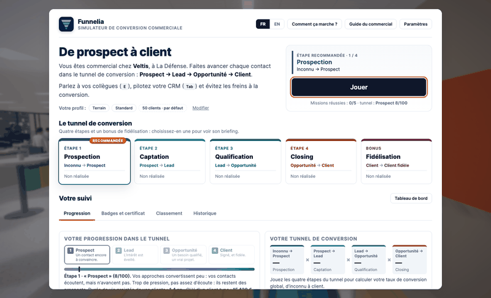

# Funnelia

**Simulateur 3D de conversion commerciale B2B, en français et en anglais.**
Vous êtes commercial chez Veltis, éditeur de logiciel fictif installé à La Défense. Mission après mission, vous faites avancer vos contacts dans le tunnel de conversion : **Prospect → Lead → Opportunité → Client**, puis vous les fidélisez.

## Jouer

- **En ligne :** https://phacquetrimbert-oss.github.io/funnelia/ (code source : https://github.com/Phacquetrimbert-oss/funnelia)
- **Sur votre ordinateur, sans installation :** téléchargez le dépôt (bouton *Code → Download ZIP*), décompressez-le, puis **double-cliquez sur `index.html`**. Le jeu fonctionne sans connexion internet et sans serveur.

Navigateurs testés : Chrome et Safari récents. Une carte graphique intégrée suffit (qualité « Moyen » par défaut, ajustée automatiquement si l'ordinateur peine).

## Ce que l'on apprend

| Mission | Passage dans le tunnel | Ce que le joueur fait |
|---|---|---|
| 1. Prospection | Inconnu → Prospect | Répartit un budget de visibilité entre des canaux, puis tient un stand de salon et qualifie les visiteurs à leur badge. |
| 2. Captation | Prospect → Lead | Règle le formulaire et l'appel à l'action du site, lit les signaux de comportement, rappelle vite les demandes de démonstration. |
| 3. Qualification | Lead → Opportunité | Mène des découvertes (SPIN, BANT), écarte les leads sans projet, fait des démonstrations ciblées. |
| 4. Closing | Opportunité → Client | Dimensionne l'offre, traite les objections, ne concède une remise que contre une contrepartie. |
| Bonus. Fidélisation | Client → Client fidèle | Suit la santé des comptes, prépare les renouvellements, mesure la satisfaction sans biais. |

Chaque mission existe en profil **terrain** ou **sédentaire** et en exigence **standard** ou **confirmé**. Le bilan donne un score, des indicateurs (KPI) et les erreurs commises ; les résultats s'exportent en CSV pour le formateur.

Formateurs : voir le [guide du formateur](docs/guide-formateur.md).

**Démo de 5 minutes** : bouton « Démo (5 min) » de l'accueil, ou `index.html?demo`. Le jeu se joue seul, chapitre par chapitre, avec des légendes ; → chapitre suivant, Espace pause, Échap quitter.

## Commandes

| Action | Clavier |
|---|---|
| Se déplacer | Z Q S D, W A S D ou flèches |
| Regarder | souris (clic dans la scène) |
| Parler, agir | E, Espace ou Entrée |
| CRM | Tab |
| Tableau de bord · équipe · guide · plan · aide | K · O · G · P · H |
| Accélérer le temps · son | F · M |
| Pause et menu | Échap |

Tout se joue aussi à la souris, et au tactile sur tablette.

## Organisation du projet

| Élément | Rôle |
|---|---|
| `index.html`, `style.css`, `script.js` | Le jeu : une page, une feuille de style, un script (Three.js r128). |
| `textes/` | Textes du jeu en français et en anglais, côte à côte (`{ fr, en }`). L'extraction depuis `script.js` est progressive : le catalogue commercial est le premier extrait. |
| `assets/personnages/` | Personnages 3D (glTF, CC0), encodés en `.js` pour fonctionner sans serveur. |
| `vendor/`, `fonts/` | Three.js r128 et la police Inter, copiés localement : aucun appel réseau. |
| `outils/` | `verifier-textes.py` (FR/EN synchronisés), `verifier-donnees.py` (aucune donnée personnelle, historique compris), `preparer-personnage.py` (allègement des modèles 3D), `remplacer-auteur.sh` (adresse des commits). |
| `docs/` | Choix de conception, mesures de performance, guides. |

Le jeu doit toujours s'ouvrir par double-clic : pas de module ES, pas de chargement de fichier par `fetch`, et Three.js reste en r128. Les raisons sont expliquées dans [CONTRIBUTING.md](CONTRIBUTING.md).

Documentation : [game design](docs/game-design.md) · [performances](docs/performances.md) · [interface](docs/ux.md) · [ouverture du code](docs/open-source.md) · [ajouter une mission](docs/ajouter-une-mission.md) · [guide du formateur](docs/guide-formateur.md).

## Contribuer

Les contributions sont bienvenues : corrections, traductions, nouvelles situations commerciales. Lisez [CONTRIBUTING.md](CONTRIBUTING.md) et le [code de conduite](CODE_OF_CONDUCT.md).

## Licences

- **Code** (`index.html`, `style.css`, `script.js`, `outils/`, `.github/`) : [MIT](LICENSE).
- **Contenus** (`textes/`, `docs/`, ce README) : [CC BY-SA 4.0](LICENSE-CONTENUS). Vous pouvez les réutiliser et les adapter en citant « Funnelia, les contributeurs de Funnelia » et en partageant vos adaptations sous la même licence.
- **Éléments de tiers** (Three.js, police Inter, personnages 3D) : leur propre licence, détaillée dans [CREDITS.md](CREDITS.md).

## Données fictives

Veltis, ses produits, ses clients, ses concurrents et toutes les personnes du jeu sont **inventés**. Toute ressemblance avec une entreprise ou une personne réelle serait fortuite. Le jeu ne collecte aucune donnée : la progression reste dans le navigateur du joueur (`localStorage`) et ne quitte l'ordinateur que si le joueur exporte lui-même le CSV.

## Contact

- **Questions, idées, bugs :** ouvrez une *issue* sur https://github.com/Phacquetrimbert-oss/funnelia/issues (publique).
- **Comportement contraire au [code de conduite](CODE_OF_CONDUCT.md) :** utilisez le bouton *Report content* de GitHub (menu « … » du message ou du profil concerné). Le signalement reste privé.

---

## In English

**Funnelia** is a 3D B2B sales conversion simulator (French and English). As a sales rep at Veltis, a fictional software company, you move contacts through the funnel: Prospect → Lead → Opportunity → Customer, then retain them. Play online (link above) or download the repository and double-click `index.html`: it runs offline, with no server. Switch to English with the **EN** button on the home screen.

Code under the MIT licence, content (`textes/`, `docs/`, README) under CC BY-SA 4.0, third-party assets listed in CREDITS.md. All companies and people in the game are fictional.
