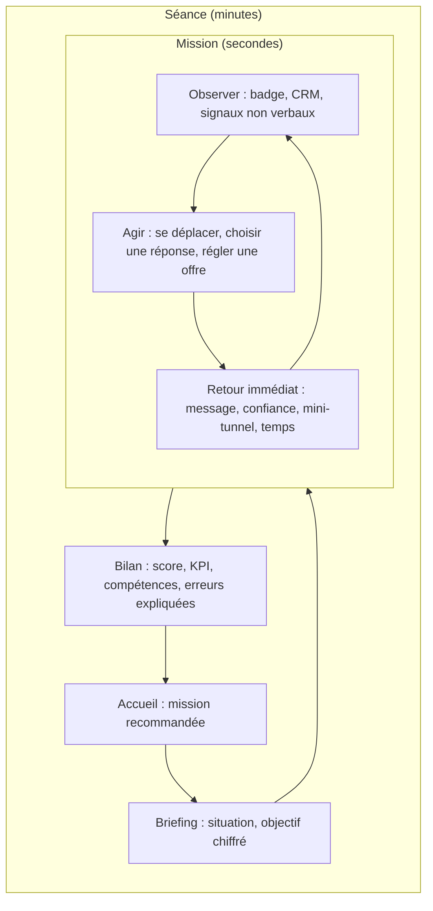

# Game design de Funnelia

Funnelia fait jouer le **tunnel de conversion B2B** (Inconnu → Prospect → Lead → Opportunité → Client, puis Client fidèle) à un commercial débutant, dans les bureaux en 3D d'un éditeur de logiciel fictif, Veltis. Chaque règle du jeu traduit une règle du métier : ce document montre lesquelles et pourquoi.

Public : étudiants en commerce et commerciaux débutants. Durée d'une mission : une séance de cours. Le jeu s'ouvre dans un navigateur, sans installation, en français ou en anglais.

## 1. La boucle de jeu

Trois boucles s'emboîtent, de la seconde à la séance.

| Boucle | Ce que fait le joueur | Ce qu'il en retire |
|---|---|---|
| **Action** (secondes) | Lit un badge ou une fiche CRM, choisit une réponse parmi 3 ou 4, règle un budget ou une offre. | Un retour immédiat : « ✓ » (bonne pratique), « à revoir » (manque) ou erreur, la jauge de confiance du client, le mini-tunnel de la mission. |
| **Mission** (une séance) | Atteint un objectif chiffré dans un temps simulé (une journée de salon, quatre jours de leads entrants, huit jours ouvrés de closing). | Un bilan : score sur 100, KPI réels de l'étape, compétences mobilisées, journal des décisions, « à retenir ». |
| **Progression** (plusieurs séances) | Enchaîne les quatre étapes du tunnel et la mission bonus, en profil terrain ou sédentaire, en exigence standard ou confirmé. | Sa propre position dans le tunnel (0 à 100), la durée de vie projetée de ses clients (CLV), des badges, un classement sur le poste, un certificat. |

## 2. Mécaniques et pédagogie

| Mécanique | Ce qu'elle fait vivre | Notion du métier |
|---|---|---|
| **Réponses mélangées à chaque dialogue** | La bonne réponse n'est jamais à la même place : il faut lire, pas mémoriser une position. | Écoute et choix argumenté. |
| **Trois niveaux de retour** : réussite, manque, erreur | Un manque (carte de visite sans prochaine étape) n'est pas une faute, une remise hors délégation en est une. | Nuance entre maladresse et faute professionnelle. |
| **Jauge de confiance** du visiteur (mission 1) | Une accroche ouverte et un argument adapté à la fonction la font monter ; un discours générique la fait baisser. | Questionnement, argumentation par fonction (DG, DAF, DSI…). |
| **Plan de visibilité sous budget** (mission 1) | Huit canaux avec coût, audience et part de cible ; certains sont des pièges (fichier acheté, radio grand public). | Ciblage, coût par visiteur, RGPD. |
| **Lecture du badge au salon** (mission 1) | Le badge (fonction, effectif) dit si le visiteur est dans la cible avant même de parler. | Cible idéale (ICP), qualification. |
| **Formulaire et appel à l'action** (mission 2) | Formulaire court ou long, contenus gradués ou « démo » seule : le joueur arbitre volume contre information. | Conversion visiteur → lead, maturité. |
| **Délai de rappel** des demandes de démonstration (mission 2) | Une demande non rappelée à temps est perdue. | Réactivité commerciale (SLA). |
| **Découverte SPIN puis BANT** (mission 3) | Les questions posées alimentent le score du lead et le contenu de la démonstration. | Qualification honnête, démonstration ciblée. |
| **Configurateur de proposition et délégation de remise** (mission 4) | Offre, licences, engagement, options, remise : le prix est recalculé en direct, et une remise au-delà de 10 % demande l'accord du manager. | Dimensionnement, négociation, contrepartie. |
| **Relances avec échéance** (mission 4) | Une opportunité en réflexion attend une relance ; si elle est oubliée, le concurrent signe. | Suivi commercial. |
| **Santé des comptes** (mission bonus) | Incidents, changement d'interlocuteur, renouvellements : la santé de chaque compte évolue. | Fidélisation, churn, NPS, CLV. |
| **Cinq erreurs au maximum** | À la cinquième, la mission s'arrête. | L'éthique et la conformité ne se négocient pas. |
| **Tunnel du joueur et CLV projetée** | Chaque bonne pratique fait monter le joueur dans son propre tunnel (de +1 à +2), une erreur le fait descendre (−2), un « frein à la conversion » (pression, fausse urgence, remise forcée) encore plus (−6). La CLV de ses clients en dépend. | Le court terme (forcer la vente) détruit la valeur à long terme. |
| **Profil terrain ou sédentaire** | Le face à face donne accès au non-verbal mais coûte du temps ; la visio limite la démonstration à 3 modules. | Coût et efficacité des canaux de vente. |
| **Temps simulé, accélérable** | La journée avance ; certaines actions coûtent des minutes. | Organisation et priorisation. |
| **Imprévus** | Une journaliste au stand, un appel ou une visite inattendus d'un client ou d'un collègue : des situations hors script, souvent éthiques. | Confidentialité, loyauté, relation client. |
| **Collègues et réseau interne** | Parler aux collègues donne des repères et fait monter le réseau interne (0 à 100). | Collaboration (marketing, ADV, manager). |
| **Aides payantes** | Demander un coup de pouce ciblé à un collègue (Léa au marketing, Yanis en avant-vente, Inès au service client) coûte 3 points ; le guide du commercial, lui, reste gratuit. | Préparer avant d'agir, et solliciter l'équipe à bon escient. |
| **Tableau de bord d'équipe** | Le joueur se compare à sept commerciaux sur le CA, le prévisionnel, la marge, la rentabilité et le tunnel. | Pilotage par indicateurs. |

**Score d'une mission réussie** : 45 + 10 par étoile + jusqu'à 25 selon la part de bonnes décisions − 4 par erreur − 3 par aide, borné entre 40 et 100. Une mission échouée plafonne à 39. Le joueur sait donc que réussir sans méthode, ou avec des erreurs, rapporte peu.

## 3. Choix artistiques

- **Un bureau crédible, sans effet « jeu vidéo »** : immeuble de trois niveaux sur l'esplanade de La Défense, lumière de fin de journée, open space, salons clients, café, signalétique. Le joueur doit se projeter dans son futur poste.
- **Une couleur par étape du tunnel** (bleu Prospection, cyan Captation, vert Qualification, ambre Closing, bordeaux Fidélisation), reprise sur les cartes, les bandeaux, l'animation de passage d'étape et le logo en entonnoir. L'étape en cours se reconnaît d'un coup d'œil.
- **Personnages stylisés** (modèles libres CC0 de Quaternius) : des visages simples évitent la « vallée de l'étrange » qu'aurait un réalisme raté, et chaque personnage ne coûte qu'un appel de dessin.
- **Tout est généré par le code** : textures, ciel, ville, sons (Web Audio), logo. Aucun fichier image ou audio de tiers, donc ni poids ni problème de licence.
- **Rendu soigné mais raisonnable** : courbe de tons ACES, halo léger, ombres calculées une fois par étage ; l'occlusion ambiante, coûteuse, est réservée à la qualité Ultra.
- **Interface en trois couches** (permanente, contextuelle, à la demande) : à chaque instant, le joueur ne lit que ce qui lui sert. Détails et mesures : [ux.md](ux.md).
- **Sons courts et rares** : clic, succès, erreur, conversion, sonnerie de relance. Ils confirment une action, ils ne décorent pas.

## 4. Accessibilité

- **Tout se joue au clavier** (déplacements, dialogues avec les touches 1 à 9, CRM, fenêtres), à la souris, ou au tactile sur tablette (manette à l'écran).
- **Réglages** : texte plus grand, animations de l'interface réduites, vue stable (sans balancement de la marche), axe vertical inversé, champ de vision, boussole et compteur d'images au choix, son coupé (M).
- **Ordinateurs modestes** : qualité « Moyen » par défaut et allègement automatique (résolution, puis halo, puis ombres) si l'image ralentit, réversible dans les Paramètres.
- **Jamais la couleur seule** : chaque retour porte une icône ou un mot (✓, « Erreur 2/5 », « Frein à la conversion »).
- **Sans installation ni réseau** : le jeu s'ouvre par double-clic, sans connexion, ce qui compte dans les salles de cours.
- **Deux langues** synchronisées, vérifiées par un outil (`outils/verifier-textes.py`).
- **Limites connues** : la scène 3D n'est pas lisible par un lecteur d'écran (les dialogues et fenêtres, en HTML, le sont en partie) ; les contrastes n'ont pas été mesurés avec un outil.

## 5. Performances avant / après

Mesures sur la machine du développeur avec le banc automatique (Maj + F3), qualité par qualité et étage par étage. Détail : [performances.md](performances.md).

| Mesure (étage R+1, qualité Moyen sauf mention) | Avant (étape 0) | Après lot 2 | Après lot 3 |
|---|---|---|---|
| Appels de dessin par image | 1 177 | 380 | **259** |
| Triangles rendus par image | 704 290 | 184 768 | **108 350** |
| Matériaux | 293 | 133 | 121 |
| Images par seconde, Moyen | 58 – 60 | 60 (plafond de l'écran) | 59,7 – 60 |
| Images par seconde, Élevé | 43 – 46 | 59 – 60 | 57,6 – 59,9 |
| Images par seconde, Ultra | 19 – 35 | 42 – 43 | 40,7 – 40,8 |
| Un personnage | 33 objets, ≈ 16 900 triangles | idem | **1 appel de dessin, ≈ 2 000 triangles** |
| Textures en mémoire | 134 → 299 (fuite) | 63 – 87, stable | stable |

Cibles du cahier des charges, par étage : moins de 300 appels de dessin ✔, moins de 300 000 triangles ✔, 60 FPS en Moyen ✔ et au moins 45 FPS en Élevé ✔ (57,6 à 59,9). Moins de 60 matériaux : non atteint (103 à 121), ce sont ceux du décor (écrans, affiches, sols).

## 6. Pour la soutenance et les tests

- **Mode démo** : bouton « Démo (5 min) » de l'accueil, ou `index.html?demo`. Le jeu se joue seul pendant 5 minutes, en 7 chapitres légendés (le défi, le briefing, la prospection au salon, le closing, le tableau de bord, le bilan, la fin). → chapitre suivant, ← reprendre, Espace pause, Échap quitter. Tout est réel (vrai moteur, vrais dialogues, vrais calculs) ; seul le chapitre « bilan » part d'une mission préparée : plan validé (avec un fichier acheté, pour montrer une erreur RGPD expliquée), cinq prospects qualifiés, tous les visiteurs de la journée passés au stand. Le bilan est ensuite calculé par le jeu. La démo ne touche jamais à la progression du joueur.
- **Tests joueurs** : l'export CSV (onglet Historique) donne, pour chaque mission terminée ou abandonnée, la durée réelle, le temps en pause, le temps passé en accéléré, le nombre d'accélérations et la durée simulée. Les abandons (retour à l'accueil, autre mission, onglet fermé) sont listés sans fausser l'historique ni le classement.
